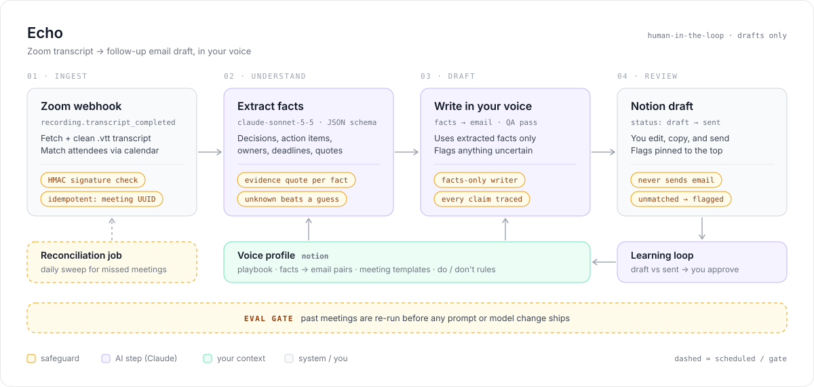

# Echo

**A web app that turns Zoom meeting transcripts into follow-up email drafts written in your own voice.**

After each Zoom meeting, Echo fetches the transcript, pulls out what was decided and who owes what, and writes a follow-up email the way you would write it. The draft lands in your Echo inbox. You review it, send it yourself, and Echo learns from your edits so the next draft sounds more like you. Drafts can also be mirrored to Notion.

Echo **never sends email**. It only creates drafts.

---

## How it works

<p align="center">
  
</p>

Amber tags mark the **safeguards**, the parts that keep the system airtight. Each one is explained in [Making it airtight](#making-it-airtight).

| # | Step | What happens | Code |
|---|---|---|---|
| 1 | **Trigger** | Zoom sends `recording.transcript_completed`. The signature is verified, the meeting is deduped, and the request is answered right away. | [`api/zoom/webhook`](src/app/api/zoom/webhook/route.ts) |
| 2 | **Fetch + clean** | Downloads the `.vtt` (it must really be WebVTT), strips timings and merges speaker turns. Plain code, no AI cost. | [`vtt.ts`](src/lib/pipeline/vtt.ts) |
| 3 | **Attendees** | Merges the calendar invite, Zoom participants and transcript speakers. Anyone without an email is flagged. | [`calendar.ts`](src/lib/calendar.ts) |
| 4 | **Extract facts** | Claude returns schema-validated JSON: decisions, action items (owner, due date), open questions, personal notes, and what to leave out. Every item has a verbatim evidence quote. | [`steps.ts`](src/lib/pipeline/steps.ts) |
| 5 | **Write in your voice** | A second Claude call writes the email from the facts only, using your playbook, rules, meeting-type template and example pairs. | [`steps.ts`](src/lib/pipeline/steps.ts) |
| 6 | **Quality check** | Claude traces every claim back to a fact, and deterministic checks catch unknown owners, missing deadlines, unmatched recipients and excluded topics. | [`steps.ts`](src/lib/pipeline/steps.ts) |
| 7 | **Inbox** | The draft appears in Echo with flags pinned at the top. Copy it or open it in your email app, send it, then click **Mark sent**. | [`drafts/[id]`](src/app/(app)/drafts/[id]/page.tsx) |
| 8 | **Learning loop** | Compares the AI draft with what you sent and proposes playbook or rule changes. Approving one creates a new voice-profile version. | [`learning.ts`](src/lib/learning.ts) |

---

## Making it airtight

### 1. Never miss a meeting, never duplicate one
| Risk | Safeguard |
|---|---|
| Forged webhook calls | Zoom's `x-zm-signature` HMAC is checked against the raw body, with a 5-minute replay window, plus the URL-validation challenge. Unsigned requests get a 401. |
| Zoom retries and you get two drafts | A unique index on the meeting's external id. Retries and reconciliation hit `onConflictDoNothing`, and the duplicate is logged and ignored. |
| The app was down when the webhook fired | `GET /api/cron/reconcile` (daily) lists recent Zoom recordings and processes any it hasn't seen. |
| Transient API errors | Exponential-backoff retries. After that the meeting is marked **failed**, with the reason, and can be retried with one click. It is never silently dropped. |
| A run dies mid-way (crash or deploy) | Reconciliation restarts meetings stuck in "processing" for more than 15 minutes, up to 3 attempts. |
| The download returns a login or error page | Only real WebVTT is accepted, so an HTML page can never be drafted as a meeting. |

### 2. Never invent facts
| Risk | Safeguard |
|---|---|
| Misattributing who agreed to what | Structured outputs (Zod schema) with an **evidence quote** on every item. The draft page shows the quote next to each fact. |
| Filling gaps with guesses | Owners and deadlines may be `"unknown"`, and an unknown is flagged. Guessing is treated as a failure in the prompt. |
| The writer adds things that weren't said | Extraction and writing are separate calls. **The writer never sees the transcript**, only the extracted facts. |
| Something still slips through | A quality check by Claude plus deterministic checks that don't depend on the model. Refusals, cut-off output and schema mismatches are errors, never partial drafts. |

### 3. Never email the wrong people
| Risk | Safeguard |
|---|---|
| Zoom doesn't have guests' emails | The Google Calendar event is matched by Zoom meeting id, falling back to the title. |
| An attendee can't be matched | They're shown as **unmatched** and flagged. Echo never guesses an address. |
| Internal talk leaks into a client email | Anything marked "exclude" during extraction is kept out of the writer's instructions, and the draft is checked for it again afterwards. |

### 4. A human is always in the loop
- Echo has **no ability to send email**. The worst case is a bad draft, never a bad email.
- Learning-loop changes are **proposals**. Nothing changes until you approve.
- Every voice-profile save is a **new version**, and you can roll back with one click.

### 5. Changes can't quietly make it worse
- **Evals** re-run past meetings with the current voice profile and the model you choose. Each case's own example is held out so the writer can't copy the answer. An LLM judge scores action-item recall, invented facts (target: 0) and tone match (1–5).
- Run them before changing the playbook, the prompts or the model, and compare the results in the table.

### 6. Security, privacy and visibility
- Single-user password login with a signed, HTTP-only session cookie. Every server action re-checks the session, not just the middleware.
- All secrets live in environment variables ([`.env.example`](.env.example)). `.env*` files and `data/` are gitignored.
- The **run log** records every step with status and timing, and **never stores transcript or email text**.
- Set a monthly **spend limit** in the Anthropic Console. Each draft shows its cost, and the inbox shows the monthly total.
- Recording consent is your responsibility. Make sure participants know meetings are recorded and transcribed.

---

## Run it locally

Requires Node 20+.

```bash
npm install
cp .env.example .env.local   # set APP_PASSWORD, SESSION_SECRET (32+ chars), MY_NAME, MY_EMAIL
npm run db:setup             # creates data/echo.db, seeds a starter voice profile + sample meeting
npm run dev                  # http://localhost:3000
```

Without `ANTHROPIC_API_KEY`, Echo runs in **mock AI mode**. Every screen and flow works with placeholder output, so you can try it before adding a key. Upload [`samples/acme-kickoff.vtt`](samples/acme-kickoff.vtt) from **New meeting** to see the whole pipeline.

```bash
npm test          # safeguard unit tests (signatures, dedupe inputs, flags, chunking, learning)
npm run typecheck
```

## Connect the integrations

All of these are optional and configured in `.env.local`. **Settings** shows which ones are active.

| Integration | Env vars | Setup |
|---|---|---|
| **Claude** | `ANTHROPIC_API_KEY`, `CLAUDE_MODEL` | Create a key at console.anthropic.com and set a spend limit. The default model is `claude-sonnet-5-5`. |
| **Zoom webhook** | `ZOOM_WEBHOOK_SECRET_TOKEN` | Zoom Marketplace → Server-to-Server OAuth app → Event subscriptions → `{APP_URL}/api/zoom/webhook`, event `recording.transcript_completed`. Turn on cloud recording with audio transcripts. |
| **Zoom API** | `ZOOM_ACCOUNT_ID`, `ZOOM_CLIENT_ID`, `ZOOM_CLIENT_SECRET` | Same app. Scopes: list user recordings, list recording files, and optionally list past participants. |
| **Reconciliation** | `CRON_SECRET` | Call `GET /api/cron/reconcile` daily with `Authorization: Bearer $CRON_SECRET`, using Vercel Cron, GitHub Actions or cron-job.org. |
| **Google Calendar** | `GOOGLE_CLIENT_ID`, `GOOGLE_CLIENT_SECRET`, `GOOGLE_REFRESH_TOKEN` | OAuth client with the `calendar.readonly` scope, plus a refresh token for your account. |
| **Notion mirror** | `NOTION_TOKEN`, `NOTION_PARENT_PAGE_ID`, `NOTION_DATABASE_ID` | Create an internal integration and share a page with it. **Settings → Create database** creates the database and gives you its id. |

## Deploy

Zoom needs a public HTTPS URL that's always up.

- **Simplest:** Railway or Render running `npm run build && npm start`, with a persistent disk for `data/` (~$5/month).
- **Serverless:** Vercel plus [Turso](https://turso.tech) (free libSQL). Set `DATABASE_URL=libsql://…` and `DATABASE_AUTH_TOKEN`, then run `npm run db:setup` once against it. Background work uses Next.js `after()`.

Set `APP_URL` to the public URL so the Settings page and Notion links point to the right place.

---

## Project structure

```
src/
  app/
    (app)/            inbox, drafts/[id], meetings/new|[id], voice, learning, evals, runs, settings
    api/zoom/webhook  signature-verified Zoom events
    api/cron/reconcile daily safety net
    actions.ts        server actions (each re-checks auth)
    login/
  lib/
    pipeline/         vtt cleaning, extract → write → quality steps, orchestrator, mock AI
    ai/claude.ts      structured outputs, cost tracking, refusal handling, mock switch
    zoom/             OAuth client, transcript download, signature verification
    db/               Drizzle schema (SQLite/libSQL), setup + seed
    calendar.ts  notion.ts  learning.ts  evals.ts  ingest.ts  voice.ts  log.ts
samples/              fictional transcript + sent email used for seeding and demos
```

**Stack:** Next.js 15 (App Router) · TypeScript · Tailwind CSS 4 · Drizzle ORM on SQLite/libSQL · Anthropic TypeScript SDK (structured outputs) · Vitest

## Estimated cost

About 85 one-hour meetings a month:

| Item | Monthly |
|---|---|
| Claude API (Sonnet 5.5, three calls per meeting) | ~$7–9 |
| Hosting | $0–7 |
| Database (SQLite file or Turso free tier) | $0 |
| Notion | $0 |
| **Total** | **~$7–16**, plus your existing Zoom plan |

## Next steps

- [ ] Replace the starter playbook in **Voice profile** with your own, and add 3–10 example pairs (transcript and the email you sent).
- [ ] Add the same meetings as **eval cases**, then compare `claude-sonnet-5-5` with `claude-opus-5-5`.
- [ ] Connect Zoom and deploy.
- [ ] Planned: email or Slack alerts for failed meetings (today they appear in the inbox and the run log), and an Outlook calendar provider.
