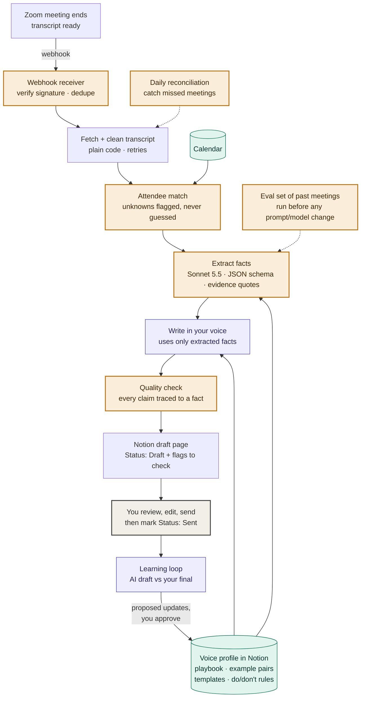

# Echo

**Turns Zoom meeting transcripts into follow-up email drafts written in your own voice.**

After each Zoom meeting, Echo fetches the transcript, pulls out what was decided and who owes what, writes a follow-up email the way you would write it, and saves it as a draft page in Notion. You review it, send it yourself, and Echo learns from your edits so the next draft is closer to your style.

> **Status:** design phase. This README describes the planned architecture; the code is being built in the order listed under [Roadmap](#roadmap).

---

## Why

Writing follow-ups is repetitive, but it can't be fully generic: what you pull out of a meeting and how you phrase it are personal. Echo automates the busywork while keeping two things under your control:

1. **Accuracy.** Every fact in the email has to come from the transcript. Nothing is invented.
2. **Your voice.** Drafts are written from your own playbook and real examples of emails you've sent.

Echo **never sends email**. It only creates drafts.

---

## How it works

**Legend:** 🟧 amber = safeguard (the parts that keep the system airtight) · 🟪 purple = AI step · 🟩 teal = your context · ⬜ gray = you

### Step by step

| # | Step | What happens |
|---|---|---|
| 1 | **Trigger** | Zoom sends a `recording.transcript_completed` webhook when the transcript is ready. |
| 2 | **Fetch + clean** | Download the `.vtt` transcript and meeting details. Strip timestamps and merge speaker turns. Plain code, no AI cost. |
| 3 | **Attendee match** | Look up the meeting in your calendar to get real attendee emails, since Zoom often doesn't have them for external guests. |
| 4 | **Extract facts** | Claude reads the transcript and returns structured JSON: summary, decisions, action items (owner, task, due date), open questions, and the personal touches you like to mention. Each item includes the transcript quote it came from. |
| 5 | **Write in your voice** | A second Claude call turns those facts into an email using your voice profile. It may only use the extracted facts. |
| 6 | **Quality check** | Checks that every claim in the email traces back to an extracted fact, and flags anything uncertain, such as "owner unclear" or "deadline guessed". |
| 7 | **Notion draft** | Creates a page in the *Meeting follow-ups* database with Status **Draft**, with the flags at the top. |
| 8 | **You send** | You edit the draft in Notion, copy it into your email client (or use the "Open in email" link), send it, and mark the page **Sent**. |
| 9 | **Learning loop** | Compares the original AI draft with your final version and proposes playbook updates for you to approve. |

---

## Making it airtight

Most of the engineering effort goes into these safeguards, the amber nodes in the diagram. Each one closes a specific way the system could fail.

### 1. Never miss a meeting, never duplicate one
| Risk | Safeguard |
|---|---|
| Fake or spoofed webhook calls | Verify Zoom's `x-zm-signature` HMAC on every request and handle Zoom's URL-validation challenge. Reject anything unsigned. |
| Zoom retries a webhook and you get two drafts | **Idempotency:** each meeting's UUID is recorded once it's processed, and repeats are ignored. |
| The service was down when the webhook fired | **Daily reconciliation job** lists the past day's Zoom recordings and processes any that were missed. |
| Transcript isn't ready yet, or the API has a temporary error | Retries with exponential backoff, and the job is marked failed (not silently dropped) after the final attempt. |

### 2. Never invent facts
| Risk | Safeguard |
|---|---|
| AI misattributes who agreed to what | Extraction returns **schema-validated JSON** in which every action item carries an **evidence quote** from the transcript. |
| AI fills gaps with guesses | Owners and deadlines may be `"unknown"`. Unknown is allowed and gets flagged. Guessing is not allowed. |
| Writing step adds things that weren't said | Writing and extraction are **separate calls**, and the writer only sees extracted facts, not the raw transcript. |
| Something still slips through | A **quality check** traces every sentence in the draft back to a fact, and anything it can't trace is flagged at the top of the page. |

### 3. Never email the wrong people
| Risk | Safeguard |
|---|---|
| Zoom doesn't provide guest emails | Attendees are matched against the **calendar event**. |
| An attendee can't be matched | They're listed as **"unmatched: please confirm"**. The system never guesses an address. |
| An internal-only discussion leaks into a client email | Do/don't rules in the voice profile, such as "never mention pricing discussed internally", are checked during the quality check. |

### 4. A human is always in the loop
- Echo has **no permission to send email**. The worst case is a bad draft, never a bad email.
- Playbook changes from the learning loop are **proposals**, applied only after you approve them.
- The voice profile is **versioned**, so a bad change can be rolled back.

### 5. Changes can't quietly make it worse
- An **eval set** of your past meetings (transcript and the email you actually sent) is re-run before any prompt or model change.
- It checks whether every action item and owner was captured correctly and how close the tone is to your real emails.
- A change ships only if it doesn't regress.

### 6. Security, privacy and visibility
- Secrets (Zoom, Claude, Notion, calendar) live in environment variables, never in code. See [`.env.example`](.env.example).
- Transcript text is never written to logs.
- Every run is recorded with a status (`processed`, `failed`, `skipped`), and failures send you an alert.
- An API **spend limit** is set in the Anthropic Console.
- Recording consent is your responsibility: make sure participants know meetings are recorded and transcribed.

---

## Tech stack

| Piece | Choice | Why |
|---|---|---|
| Runtime | Small cloud service (serverless or ~$5/mo host) | Must be reachable by Zoom's webhook 24/7 |
| AI | Claude API, **Claude Sonnet 5.5** | Accurate extraction and tone at about half the cost of Opus. To be confirmed against Opus 5.5 on the eval set. |
| Drafts + voice profile | **Notion API** (internal integration) | Free, a non-expiring token, and structured pages with statuses |
| Meetings | **Zoom** Server-to-Server OAuth app | Webhooks and transcript download (requires cloud recording with audio transcripts) |
| Attendees | Google Calendar or Outlook calendar API | Real attendee emails |
| State | SQLite or Postgres | Dedupe records and the run log |

## Estimated cost

About 85 meetings a month (20 one-hour meetings a week):

| Item | Monthly |
|---|---|
| Claude API (Sonnet 5.5, two calls per meeting) | ~$7 |
| Hosting | $0–7 |
| Notion | $0 |
| **Total** | **~$7–14** (plus your existing Zoom plan) |

---

## Notion setup

**Database: *Meeting follow-ups***

| Property | Type |
|---|---|
| Meeting | Title |
| Date | Date |
| Meeting type | Select (Client / Sales / Internal) |
| To | Text |
| Subject | Text |
| Status | Status (Draft → Reviewed → Sent) |
| Flags | Multi-select |
| Zoom link | URL |

**Each page contains:** flags to check, the email draft, extracted facts (collapsed), the original AI draft (collapsed, used by the learning loop), and the transcript (collapsed).

**Voice profile page:** your conversion playbook, 3–10 *facts → email* example pairs, templates for each meeting type, and do/don't rules.

---

## Roadmap

1. **Voice profile + AI steps.** Write the playbook from real examples, build extraction and writing, and test them on transcript files. Compare Sonnet 5.5 with Opus 5.5 on the eval set.
2. **Notion output.** Create the database and generate draft pages automatically.
3. **Zoom + calendar.** Add the webhook with signature checks, dedupe, reconciliation and attendee matching.
4. **Learning loop.** Compare drafts with sent versions and propose playbook updates.
5. **Hardening.** Add alerts, the run log, and a regression gate on the eval set.

## What's needed to start

- [ ] 3–5 past meeting transcripts and the follow-up emails you sent for them
- [ ] An Anthropic API key with a monthly spend limit
- [ ] A Notion internal integration token and a page shared with it
- [ ] A Zoom plan with cloud recording and audio transcripts enabled
